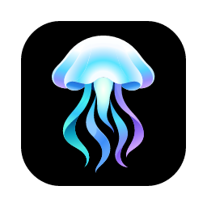

<p align="center">
  
</p>

<h1 align="center">Touchless</h1>

<p align="center">Tap <kbd>⌥</kbd><kbd>⌘</kbd>, speak, tap again.<br>Your words appear wherever your cursor is.</p>

## Install

You need macOS, [Rust](https://rustup.rs) and [Homebrew](https://brew.sh). CMake builds whisper.cpp for local models.

```sh
brew install cmake
cargo install tauri-cli --version '^2' --locked
./scripts/install.sh
```

Touchless opens in your menu bar. To update, run `git pull && ./scripts/install.sh`.

## Get an ElevenLabs API key (optional)

ElevenLabs Scribe is the default and shows your words as you speak. It has a free plan, so you can try Touchless without paying. You can skip it and [use a local model](#use-a-local-model) instead.

1. Sign up at [elevenlabs.io](https://elevenlabs.io).
2. Open [Developers → API Keys](https://elevenlabs.io/app/developers/api-keys) and click **Create key**. Speech to Text access is all Touchless needs.
3. In Touchless, open **Settings**, paste the key under **ElevenLabs**, and allow the permissions macOS asks for.

## Use a local model

Whisper runs on your Mac, so your audio never leaves it and no key is needed.

1. Open **Settings → Models**.
2. Download **Whisper Large v3 Turbo** (1.6 GB, best accuracy), **Medium** (1.5 GB) or **Small** (488 MB, fastest), then click **Use**.

With a local model, the text appears when you stop talking. **Rewrite** uses OpenAI, if you connect it under **Settings → Services** with an API key or by signing in with your ChatGPT subscription.
